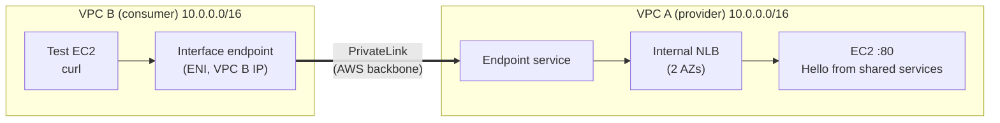

# AWS PrivateLink Lab: Shared Services Across VPCs

Hands-on lab for the **AWS Certified Solutions Architect – Associate** exam.
It rebuilds a real exam scenario with **CloudFormation**, step by step, and links every decision to the **AWS Well-Architected Framework**.

> **Status:** Steps 1–4 done (provider side). Steps 5–6 (consumer side + test) coming next.

---

## Table of contents

1. [The exam question](#1-the-exam-question)
2. [What is PrivateLink?](#2-what-is-privatelink)
3. [Architecture](#3-architecture)
4. [How PrivateLink works here](#4-how-privatelink-works-here)
5. [Step-by-step build](#5-step-by-step-build)
6. [CLI commands](#6-cli-commands)
7. [FAQ](#7-faq)
8. [Well-Architected mapping](#8-well-architected-mapping)
9. [Exam tips](#9-exam-tips)
10. [Cost and cleanup](#10-cost-and-cleanup)

---

## 1. The exam question

A company has **50+ AWS accounts**, each with **at least 4 VPCs** (200+ VPCs in total). Every VPC must reach **one shared services VPC**.

**How do they do it with the least operational overhead?**

| Option                                                         | Verdict | Why                                                                                                        |
| -------------------------------------------------------------- | ------- | ---------------------------------------------------------------------------------------------------------- |
| ALB + CAA record in Route 53                                   | ❌      | A CAA record only controls which certificate authorities can issue certificates. It doesn't route traffic. |
| VPC peering to each VPC                                        | ❌      | 200+ connections, each needing acceptance and route updates. Not transitive. CIDRs can't overlap.          |
| **NLB + PrivateLink (endpoint service + interface endpoints)** | ✅      | Publish the service **once**. Each VPC adds **one endpoint**. No routes. Overlapping CIDRs are fine.       |
| VPN per VPC                                                    | ❌      | 200+ VPN connections over the internet. The most overhead.                                                 |

This lab builds a mini version: **1 provider VPC + 1 consumer VPC**. PrivateLink works the same with 1 consumer or 200.

---

## 2. What is PrivateLink?

A way to **publish one service** from a VPC so other VPCs can use it **privately, without connecting the networks**.

**Analogy: a shop counter.** The consumer can ask for the one service at the counter, but can't walk into the warehouse (the rest of the provider VPC).

| Side                 | Builds                                                     | Role                                                      |
| -------------------- | ---------------------------------------------------------- | --------------------------------------------------------- |
| **Provider** (VPC A) | Service → **Network Load Balancer** → **Endpoint service** | Publishes the service                                     |
| **Consumer** (VPC B) | **Interface endpoint**                                     | A private IP inside its own VPC that leads to the service |

**Peering connects two networks. PrivateLink connects a consumer to one service.**

---

## 3. Architecture



Both VPCs use the **same CIDR (10.0.0.0/16) on purpose**. VPC peering would be refused, but PrivateLink works fine.

| Step | What                                         | Where | Status |
| ---- | -------------------------------------------- | ----- | ------ |
| 1    | Two VPCs, same CIDR, 2 subnets each in 2 AZs | Both  | ✅     |
| 2    | "Shared service" EC2 + security group        | VPC A | ✅     |
| 3    | Internal NLB + target group + listener       | VPC A | ✅     |
| 4    | Endpoint service + allowed principals        | VPC A | ✅     |
| 5    | Interface endpoint                           | VPC B | ⬜     |
| 6    | Test EC2 + `curl`                            | VPC B | ⬜     |

---

## 4. How PrivateLink works here

1. **Test EC2** (VPC B) calls the endpoint's DNS name.
2. DNS resolves to the **endpoint ENI**, which has a **private IP from VPC B**. To the consumer, it looks local.
3. **AWS carries the traffic** over its private network to VPC A. No routes, no internet.
4. The **endpoint service** hands the traffic to the NLB it publishes.
5. The **NLB** sends it to a healthy target.
6. The **EC2 instance** replies, and the reply goes back the same way.

**The trick: AWS translates the addresses in the middle.**

- The consumer only ever sees an IP **in its own VPC** (the endpoint ENI).
- The instance only ever sees the **NLB's IP in its own VPC**.

So:

- **Overlapping CIDRs don't matter.**
- **No route tables change.** It's a service connection, not a network connection.
- **The consumer reaches only this service** (port 80 behind the NLB), not the rest of VPC A.
- **One direction only:** the consumer starts the connection. VPC A can never reach into VPC B.

**Scaling to 200+ VPCs:** the provider builds once (service, NLB, endpoint service, permissions). Each new consumer only adds one interface endpoint. Nothing changes in VPC A.

---

## 5. Step-by-step build

Everything lives in **one template** ([`privatelink-lab.yaml`](privatelink-lab.yaml)) that grows each step. You **update the same stack** each time, so you can see exactly what every step adds. The template is fully commented.

### Step 1: Two VPCs

- **VPC A (provider)** and **VPC B (consumer)**, both `10.0.0.0/16`.
- 2 subnets each (`10.0.1.0/24`, `10.0.2.0/24`) in **2 AZs**, using `!Select [0, !GetAZs '']` so the template works in any Region.
- `EnableDnsSupport` and `EnableDnsHostnames` turned on so endpoint DNS names resolve.
- **Fully private.** No route tables are defined, so every subnet uses the VPC's **main route table**, which has only `10.0.0.0/16 → local`. There's no Internet Gateway.

### Step 2: The shared service (VPC A)

- `t3.micro`, latest **Amazon Linux 2023**, read from SSM Parameter Store (no hard-coded AMI IDs).
- User data starts a tiny web server: `python3 -m http.server 80` serving "Hello from shared services". Python is pre-installed, so no internet is needed.
- **Security group:** TCP 80 only from `10.0.0.0/16` (VPC A).
  With PrivateLink, the instance never sees VPC B. Traffic arrives from the **NLB's private IPs in VPC A**, plus health checks.

### Step 3: Internal NLB (VPC A)

- **Target group:** TCP 80 → the EC2 instance, with a TCP health check every 10s.
- **NLB:** `Scheme: internal`, in **both VPC A subnets** (one node per AZ).
- **Listener:** TCP 80 → forward to the target group.
- **Cross-zone load balancing = on.** The only instance is in AZ1. Without cross-zone (the NLB default), the AZ2 node has no targets. The consumer's endpoint in AZ2 talks to that AZ2 node, so its requests would fail.
  In production, put targets in **every AZ** instead (cross-zone can add inter-AZ data charges).

### Step 4: Endpoint service (VPC A)

- **Endpoint service:** publishes the NLB through PrivateLink.
- **Two gates control access:**
  1. **Allowed principals:** which accounts can even request a connection. Here: `arn:aws:iam::<account-id>:root`. For cross-account, add each consumer account. **Never use `*`.**
  2. **Acceptance required = false:** connections from allowed principals are accepted automatically. With 200+ VPCs, manual approval would be a lot of overhead, and gate 1 already limits who can ask.
- **Service name** (in Outputs): `com.amazonaws.vpce.<region>.vpce-svc-...`. This is the "address" you share with consumers.
- The endpoint service is **free** for the provider.

| Exam question wording           | Template                    |
| ------------------------------- | --------------------------- |
| "NLB across the AZs"            | `ServiceNLB`                |
| "Service consumer roles in IAM" | `AllowedPrincipals`         |
| "Automatically accept"          | `AcceptanceRequired: false` |
| "Consumer endpoint in each VPC" | Step 5                      |

### Step 5: Interface endpoint (VPC B) – coming next

### Step 6: Test with `curl` from VPC B – coming next

---

## 6. CLI commands

Run from the folder that contains the template.

```bash
# Check your setup
aws sts get-caller-identity
aws configure get region

# Validate
aws cloudformation validate-template --template-body file://privatelink-lab.yaml

# Preview changes (change set), then deploy (creates the 1st time, updates after)
aws cloudformation deploy --template-file privatelink-lab.yaml \
  --stack-name privatelink-lab --no-execute-changeset
aws cloudformation deploy --template-file privatelink-lab.yaml \
  --stack-name privatelink-lab

# Status and outputs
aws cloudformation describe-stacks --stack-name privatelink-lab \
  --query "Stacks[0].StackStatus"
aws cloudformation describe-stacks --stack-name privatelink-lab \
  --query "Stacks[0].Outputs" --output table

# Why did it fail?
aws cloudformation describe-stack-events --stack-name privatelink-lab \
  --query "StackEvents[?contains(ResourceStatus,'FAILED')].[LogicalResourceId,ResourceStatusReason]" \
  --output table

# Step 1: confirm the subnets are private (only a "local" route)
aws ec2 describe-route-tables --filters "Name=vpc-id,Values=<VpcId>" \
  --query "RouteTables[].Routes[]" --output table

# Step 3: is the target healthy?
aws elbv2 describe-target-health --target-group-arn <ServiceTargetGroupArn> \
  --query "TargetHealthDescriptions[].TargetHealth.State"

# Step 4: endpoint service state and permissions
aws ec2 describe-vpc-endpoint-service-configurations \
  --query "ServiceConfigurations[].[ServiceName,ServiceState,AcceptanceRequired]" --output table
aws ec2 describe-vpc-endpoint-service-permissions --service-id <EndpointServiceId>

# Cleanup
aws cloudformation delete-stack --stack-name privatelink-lab
aws cloudformation wait stack-delete-complete --stack-name privatelink-lab
```

---

## 7. FAQ

**Are the subnets private?**
Yes. There's no Internet Gateway, and the main route table only has the `local` route. The two VPCs can't talk to each other either. PrivateLink solves that **without adding any route**.

**Does the NLB open the VPC to the internet?**
No, because it's **internal** (private IPs only). VPC A also has no Internet Gateway. The only way in is the endpoint service, and only for allowed principals.

| Scheme          | Gets        | Reachable from                           |
| --------------- | ----------- | ---------------------------------------- |
| Internet-facing | Public IPs  | The internet (needs an Internet Gateway) |
| **Internal**    | Private IPs | Inside the VPC, and through PrivateLink  |

**Why an NLB and not an ALB?**
PrivateLink endpoint services **only accept an NLB** (or a Gateway Load Balancer for appliances). PrivateLink works at **layer 4** (TCP/UDP), and the NLB is a layer-4 load balancer. If you need ALB features, put the ALB **behind** the NLB (an NLB target group of type `alb`).

**In which VPC is the NLB?**
**VPC A (provider)**, next to the service it fronts. Consumers never get an NLB, only an interface endpoint.

**How is the DNS name created?**
Automatically. AWS generates `vpce-...vpce.amazonaws.com` when the interface endpoint is created. For a friendly name like `shared.mycompany.com`, you have two options:

- The provider sets a **private DNS name** on the endpoint service (domain ownership is verified with a TXT record), and consumers enable private DNS.
- The consumer creates a **Route 53 private hosted zone** with a record pointing to the endpoint.

**Do we need SSL/TLS?**
It's **not needed for PrivateLink to work**, because the traffic stays on the AWS network. This lab uses HTTP to keep things simple. For **production it's recommended (SEC09-BP02)**. Options:

- A **TLS listener on the NLB** with an **ACM certificate** (offloads encryption, and ACM auto-renews it, per SEC09-BP01).
- **TCP 443 pass-through**, where the instance handles TLS itself.

The certificate must match the name clients use, so in practice you pair TLS with a friendly private DNS name.

---

## 8. Well-Architected mapping

| Pillar / best practice                                         | Where it shows up                                                                                                          |
| -------------------------------------------------------------- | -------------------------------------------------------------------------------------------------------------------------- |
| **OPS** – Perform operations as code                           | Whole lab in one CloudFormation template                                                                                   |
| **OPS** – Make frequent, small, reversible changes             | One step per update, change-set preview, one-command delete                                                                |
| **SEC03** – Grant least privilege                              | Allowed principals = only the accounts that need the service, never `*`                                                    |
| **SEC05-BP01** – Create network layers                         | Private subnets, no Internet Gateway                                                                                       |
| **SEC05-BP02** – Control traffic at all layers                 | SG opens only TCP 80 from VPC A. Internal NLB. PrivateLink: only the consumer initiates, traffic stays on the AWS backbone |
| **SEC06** – Protect compute                                    | No public IP, no SSH, no internet on the instance                                                                          |
| **SEC09-BP01 / BP02** – Certificates and encryption in transit | Production: TLS on the NLB with ACM                                                                                        |
| **REL02-BP03** – IP allocation for expansion and availability  | Subnets in 2 AZs, `/16` leaves room to grow                                                                                |
| **REL02-BP04** – Prefer hub-and-spoke over many-to-many mesh   | One endpoint service (hub), many consumer endpoints (spokes). Peering among many VPCs is an anti-pattern                   |
| **REL10** – Use fault isolation (multiple AZs)                 | NLB in 2 AZs. Production: targets in every AZ                                                                              |
| **PERF05** – Use load balancing                                | NLB for layer 4, high performance, low latency                                                                             |
| **COST** – Avoid unused resources                              | Delete the stack when finished                                                                                             |

---

## 9. Exam tips

- **Many VPCs/accounts → one service, least overhead** → **PrivateLink (NLB + endpoint service)**.
- **All VPCs must talk to each other** → **Transit Gateway**.
- **Overlapping CIDRs** → PrivateLink works. Peering and Transit Gateway routing don't.
- **PrivateLink endpoint service** → always an **NLB** (or GWLB). An option with an **ALB** as the endpoint service is wrong.
- **Peering** is not transitive and gets heavy beyond a few VPCs.
- Ask yourself: **"How many connections do I have to create and maintain?"**

---

## 10. Cost and cleanup

| Resource                                         | Billing                                       |
| ------------------------------------------------ | --------------------------------------------- |
| VPCs, subnets, security groups, endpoint service | Free                                          |
| EC2 `t3.micro`                                   | Per hour (Free Tier eligible on new accounts) |
| Network Load Balancer                            | Per hour + usage                              |
| Interface endpoint (Step 5)                      | Per hour per AZ + per GB                      |

⚠️ **Delete the stack when you finish:**

```bash
aws cloudformation delete-stack --stack-name privatelink-lab
aws cloudformation wait stack-delete-complete --stack-name privatelink-lab
```
